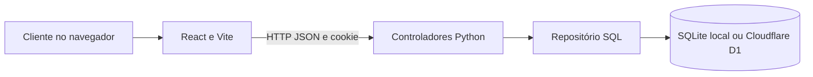
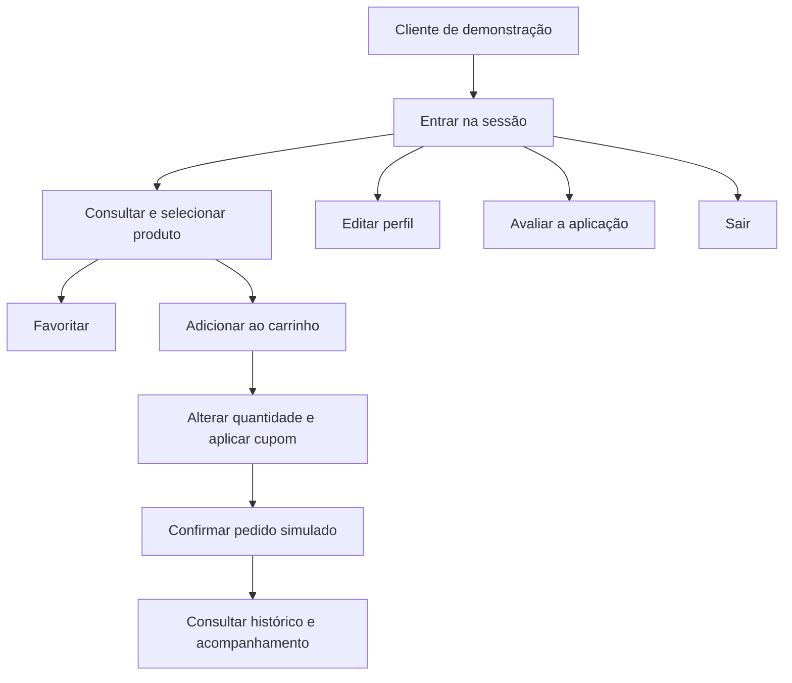
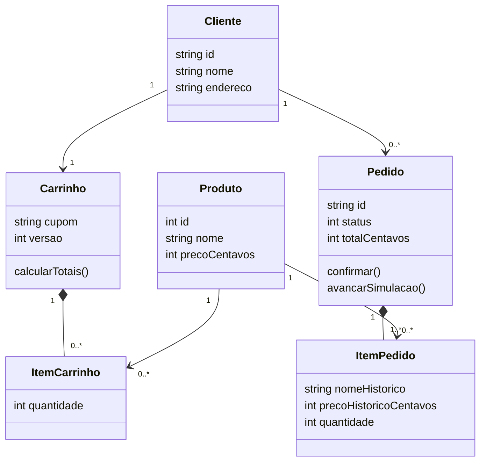
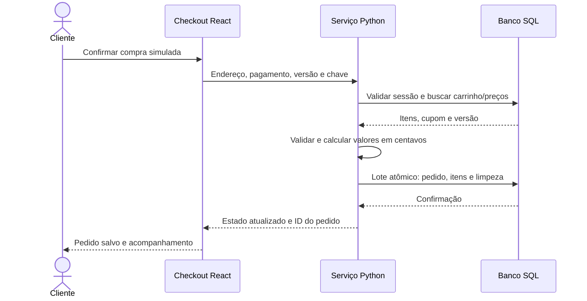
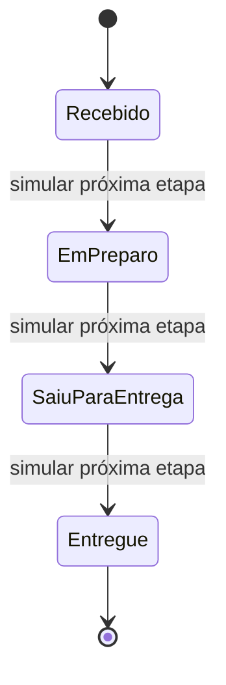

# Arquitetura e modelagem da SweetCup

## Separação de responsabilidades

As telas React representam a apresentação. `App.tsx` coordena navegação e estado retornado pela API; `api.ts` concentra as requisições. No servidor, `service.py` reúne os controladores e regras do domínio. `repository.py` executa SQL usando SQLite local ou o binding D1 na Cloudflare. `local_server.py` e `entry.py` adaptam HTTP aos mesmos controladores.

Essa organização aplica separação inspirada em MVC em uma aplicação web: apresentação no React, controle no serviço Python e modelo relacional/repositório. Não se afirma que o React, isoladamente, seja um framework MVC.

## Casos de uso

O ator cliente de demonstração pode entrar, consultar produtos, pesquisar, filtrar, favoritar, montar carrinho, aplicar cupom, finalizar pedido, acompanhar pedidos, editar perfil, avaliar a aplicação e sair. Finalizar pedido inclui validar carrinho, calcular valores, salvar pedido/itens e limpar o carrinho. A entrega é avançada explicitamente como simulação.

## Classes do domínio

## Sequência da compra

Se o carrinho mudou, o servidor retorna 409 e a interface recarrega os valores. Se a chave já corresponde a um pedido do cliente, o servidor retorna esse pedido. Falhas no lote não deixam pedido parcialmente gravado.

## Estados do pedido

## Navegação atualizada

A entrada inicia a sessão e abre o catálogo. A navegação inferior oferece Início, Favoritos, Carrinho, Pedidos e Perfil. Produto abre o carrinho; carrinho abre pagamento; pagamento cria o pedido e abre acompanhamento. Perfil abre avaliações e histórico. Os mapas e wireframes originais permanecem acessíveis como referência do PIT I; os fluxos do PIT II são documentados aqui.
