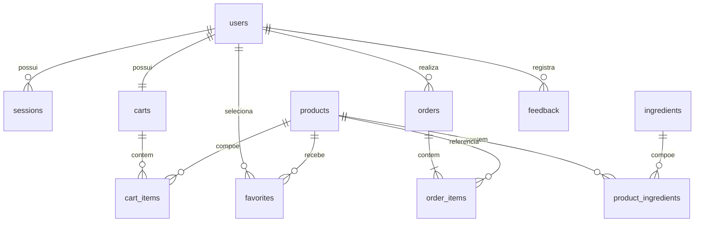

# Banco de dados: modelo, implementação e dicionário

O modelo usa SQLite no computador e o mesmo esquema SQL no Cloudflare D1. Os arquivos `database/001_schema.sql` e `database/002_seed.sql` implementam a estrutura e os oito produtos fictícios. O seed é idempotente e não sobrescreve produtos existentes.

## Modelo conceitual e lógico

As tabelas associativas usam chaves compostas para impedir duplicidade de produto no mesmo carrinho, favorito ou pedido. Campos de usuários e produtos ficam nas entidades correspondentes; carrinhos não copiam dados de perfil. Pedidos e seus itens preservam endereço, nome e preço da compra como retratos históricos, para que mudanças posteriores não alterem uma compra já concluída.

O catálogo também separa ingredientes e sua associação com produtos em `ingredients` e `product_ingredients`. Cada ingrediente é identificado uma vez; a associação registra a ordem de apresentação. O modelo evita listas em colunas e repetição de atributos de outras entidades. A cópia histórica dos itens do pedido é intencional para preservar a compra, conforme explicado acima.

## Dicionário de dados

| Tabela | Campos | Domínio e finalidade |
|---|---|---|
| users | id TEXT PK; name TEXT; address TEXT; created_at TEXT | ID aleatório; nome de 2 a 80 caracteres; endereço fictício; criação ISO 8601 UTC |
| sessions | token_hash TEXT PK; user_id TEXT FK; expires_at INTEGER | Hash SHA-256 do token; cliente; expiração em segundos Unix |
| products | id INTEGER PK; name TEXT; price_cents INTEGER; description TEXT; image TEXT; category TEXT; rating REAL; reviews INTEGER | Preço positivo em centavos; demais campos do catálogo fictício |
| ingredients | id INTEGER PK; name TEXT UNIQUE | Nome único de ingrediente |
| product_ingredients | product_id INTEGER PK/FK; ingredient_id INTEGER PK/FK; position INTEGER | Relação entre produto e ingrediente, com ordem de apresentação |
| carts | user_id TEXT PK/FK; coupon TEXT; version INTEGER | Um carrinho por cliente; cupom vazio/SWEET10/PROMO20; versão de concorrência |
| cart_items | user_id TEXT PK/FK; product_id INTEGER PK/FK; quantity INTEGER | Chave composta; quantidade de 1 a 20; zero é representado pela exclusão do item |
| favorites | user_id TEXT PK/FK; product_id INTEGER PK/FK | Chave composta sem repetição |
| orders | id TEXT PK; user_id TEXT FK; request_key TEXT; created_at TEXT; status INTEGER; subtotal_cents INTEGER; discount_cents INTEGER; delivery_cents INTEGER; total_cents INTEGER; coupon TEXT; payment TEXT; address TEXT | Chave de compra única por cliente; status 0 a 3; total = subtotal - desconto + entrega; pagamento pix/card/cash, sempre simulado |
| order_items | order_id TEXT PK/FK; product_id INTEGER PK/FK; product_name TEXT; price_cents INTEGER; quantity INTEGER | Retrato do item comprado; preço positivo; quantidade 1 a 20 |
| feedback | id TEXT PK; user_id TEXT FK; tester_name TEXT; tested_at TEXT; worked TEXT; failed TEXT; untested TEXT; created_at TEXT | Nome e data informados pelo participante; relatos reais; data YYYY-MM-DD validada; criação UTC |

Todas as colunas são NOT NULL, salvo se o SQL indicar o contrário; neste esquema todas estão declaradas como obrigatórias, com valores padrão quando cabível. As FKs são ativadas no servidor local; o D1 aplica suas regras de chaves estrangeiras. Índices cobrem pedidos por cliente/data e expiração das sessões. A chave UNIQUE de pedidos cobre cliente e chave de requisição.

## Projeto físico e acesso

Consultas usam parâmetros, sem concatenar entradas do usuário. `SQLiteRepository.batch` usa uma transação e fecha as conexões explicitamente. `D1Repository.batch` usa o lote transacional do D1. O checkout só insere o pedido se a versão do carrinho ainda corresponde à versão conferida, e os comandos seguintes dependem da existência desse pedido.

No servidor local, o arquivo fica em `data/sweetcup.sqlite3`, fora do repositório. `SWEETCUP_DB` permite escolher outro arquivo. No D1, o identificador deve ser preenchido em `wrangler.jsonc` depois de criar o recurso. O valor de exemplo no arquivo não identifica um banco publicado.

Os limites de tamanho de nome/endereço/relatos e a validação de data são também aplicados no serviço Python. O esquema não deve ser usado como substituto dessa camada de validação.
